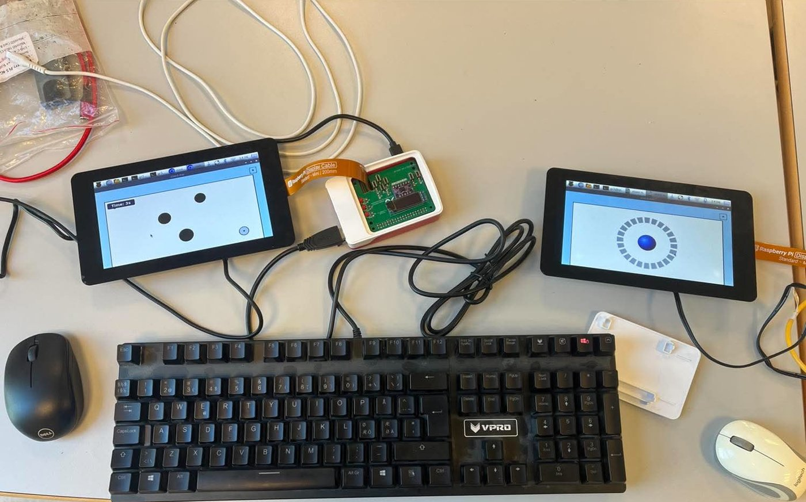

# Ready Player Pi

A cooperative two-player game across three Raspberry Pis: one server and two touchscreen controllers. In **GyroPi**, one player tilts a controller to roll a ball through a maze that only the other player can see. In **NotePi**, one player plays notes and the other gets Wordle-style feedback.

3rd-semester group project (8 students), Software Technology, Aarhus University. Grade 12.



## How it works
- Clients and server communicate over TCP with newline-framed JSON messages.
- The server forks a separate process for each running game.
- Sensor and network threads update the Qt GUI through its event queue, so the GUI never blocks.

## My part
- Designed, built and tested the Qt GUI: 16 classes, all sharing a `BaseMenu` base class.
- Worked on the TCP/JSON communication and the lobby use cases.

## Run
```bash
cmake -B build && cmake --build build
./build/server                # server Pi, port 9000
./build/client <server-ip>    # each controller
```

C++17 · Qt 6 · CMake · TCP sockets · JSON · Raspberry Pi
